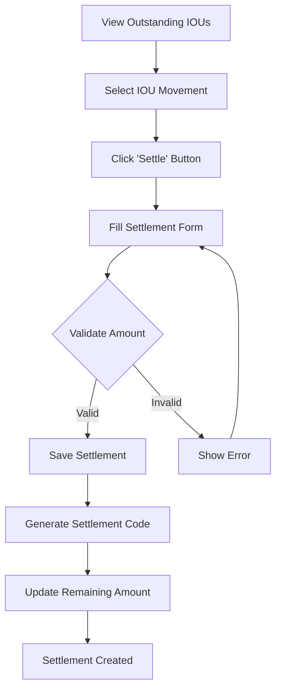

# IOU Settlement System Procedure Guide

## Overview
The IOU (I Owe You) Settlement System manages the settlement process for cash movements with source type "IOU". This system allows tracking and settling outstanding IOU amounts through various settlement methods.

---

## System Architecture

### 1. Database Structure

#### Tables Involved:
- **`cashier_cash_movements`**: Stores the original IOU cash movements
  - `status`: ENUM('pending','approved','settled','cancel')
  - `source_id`: Foreign key to `cashier_cash_movement_sources` (code='iou')
  - `movement_type`: Must be 'cash_out'
  - `amount`: Total IOU amount
  - `is_confirm`: Determines series (1=Series 1, 0=Series 2)

- **`iou_settlements`**: Stores settlement records
  - `code`: Auto-generated settlement code (Series 1 or Series 2)
  - `cash_movement_id`: Links to the original IOU movement
  - `settlement_type`: ENUM('cash_return','expense_claim','payroll_deduction')
  - `settlement_amount`: Amount being settled
  - `settlement_date`: Date of settlement
  - `reference_id`: Optional reference (e.g., expense claim ID, payroll ID)
  - `remarks`: Optional notes
  - `is_confirm`: Inherited from cash movement (1=Series 1, 0=Series 2)
  - `status`: ENUM('active','deactive','delete')

### 2. Series System (is_confirm)
- **Series 1** (is_confirm = 1): Primary series, default
- **Series 2** (is_confirm = 0): Secondary series
- Each series maintains separate code sequences
- Series filtering available in listings via `include_series2` parameter

---

## Workflow Procedure

### Phase 1: IOU Creation
1. **Create Cash Movement**
   - Movement Type: `cash_out`
   - Source: `iou` (from `cashier_cash_movement_sources`)
   - Amount: Total IOU amount
   - Status: Initially `pending`
   - Series: Set via `is_confirm` field (1 or 0)

2. **Approval Process**
   - IOU must be approved (status = `approved`)
   - Only approved IOUs can have settlements created
   - Cannot cancel approval if settlements exist

3. **Code Generation**
   - Draft code: `DRFT-YYM-XXX` (during creation)
   - Final code: Generated on approval (e.g., `IOU-YYM-XXX`)
   - Code format based on source code + series

---

### Phase 2: Settlement Creation

#### Step 1: View Outstanding IOUs
- Access: Outstanding IOUs DataTable
- Filters:
  - Only approved IOU movements
  - Movement type: `cash_out`
  - Source: `iou`
  - Status: `approved`
  - Shows remaining amount (total amount - sum of all settlements)

#### Step 2: Create Settlement
**Required Fields:**
- `cash_movement_id`: Selected IOU movement (auto-populated)
- `settlement_type`: Choose one:
  - **cash_return**: Employee returns cash
  - **expense_claim**: Settled via expense claim
  - **payroll_deduction**: Deducted from payroll
- `settlement_amount`: Amount to settle (must not exceed remaining)
- `settlement_date`: Date of settlement

**Optional Fields:**
- `reference_id`: Reference number (expense claim ID, payroll ID, etc.)
- `remarks`: Additional notes

**Validation Rules:**
1. Settlement amount must be > 0
2. Settlement amount cannot exceed remaining IOU amount
3. Cash movement must exist and be approved IOU type
4. Cash movement must belong to same branch

#### Step 3: Code Generation
- Settlement code generated based on:
  - Document type: `iou_settlement`
  - Series: Inherited from cash movement's `is_confirm`
  - Format: `IOU-STL-YYM-XXX` (Series 1) or `IOU-STL2-YYM-XXX` (Series 2)

---

### Phase 3: Settlement Tracking

#### Calculation Logic:
```
Remaining Amount = Cash Movement Amount - Sum of All Active Settlements
```

**Settlement Status:**
- **Partially Settled**: Sum of settlements < Total amount
- **Fully Settled**: Sum of settlements = Total amount
- **Over Settled**: Sum of settlements > Total amount (prevented by validation)

#### Multiple Settlements:
- Multiple settlements allowed per IOU
- Can mix settlement types (e.g., partial cash return + payroll deduction)
- Each settlement tracked independently
- Total cannot exceed original IOU amount

---

## Settlement Types Explained

### 1. Cash Return (`cash_return`)
- **Purpose**: Employee physically returns cash
- **Use Case**: Employee received advance, returns unused/excess cash
- **Process**:
  1. Employee returns cash to cashier
  2. Cashier creates settlement with type "cash_return"
  3. Cash recorded back to cashier shift
  4. IOU balance reduced

### 2. Expense Claim (`expense_claim`)
- **Purpose**: IOU settled via approved expense claim
- **Use Case**: Employee spent money on company expenses, claims reimbursement
- **Process**:
  1. Employee submits expense claim
  2. Expense claim approved
  3. Create settlement with type "expense_claim"
  4. Link via `reference_id` (expense claim ID)
  5. Amount offset against IOU

### 3. Payroll Deduction (`payroll_deduction`)
- **Purpose**: Amount deducted from employee salary
- **Use Case**: Recover IOU amount through payroll
- **Process**:
  1. HR/Payroll processes deduction
  2. Create settlement with type "payroll_deduction"
  3. Link via `reference_id` (payroll transaction ID)
  4. Amount deducted from salary, IOU cleared

---

## System Procedures

### Procedure 1: Create New Settlement



**Steps:**
1. Navigate to IOU Settlements page
2. View Outstanding IOUs table
3. Identify IOU to settle (check remaining amount)
4. Click "Settle" button on desired row
5. Modal opens with pre-filled `cash_movement_id`
6. Select settlement type
7. Enter settlement amount (validate against remaining)
8. Select settlement date
9. Optionally add reference ID and remarks
10. Submit form
11. System validates and creates settlement
12. Code auto-generated based on series
13. Remaining amount recalculated

---

### Procedure 2: Edit Settlement

**Conditions:**
- Settlement can be edited
- Settlement date and amount can be modified
- Amount validation still applies (cannot exceed remaining + current settlement amount)

**Steps:**
1. View Settlements List
2. Click "Edit" on settlement record
3. Modify fields (amount, date, reference, remarks)
4. System validates new amount
5. Save changes

---

### Procedure 3: View Settlement History

**Views Available:**
1. **Outstanding IOUs Table**
   - Shows IOUs with remaining balance > 0
   - Displays: Code, Shift, Payee, Amount, Remaining, Payment Type, Created At
   - Filter by Series (include_series2 parameter)

2. **Settlements List Table**
   - Shows all settlements
   - Displays: Code, IOU Movement, Settlement Type, Amount, Date, Reference, Remarks, Settled By
   - Filter by Series
   - Filter by Settlement Type
   - Filter by IOU Movement

**Filtering:**
- **Series Filter**: Use `include_series2` parameter
  - Default: Shows only Series 1 (is_confirm = 1)
  - Include Series 2: Set `include_series2=1` (secret code: "boom")

---

### Procedure 4: Delete/Cancel Settlement

**Note**: Based on code structure, settlements use soft delete (`status = 'delete'`)

**Process:**
1. Mark settlement as deleted (status = 'delete')
2. Remaining IOU amount recalculated (deleted settlements excluded)
3. IOU becomes available for new settlements

---

## Business Rules & Validation

### Validation Rules:
1. ✅ Only approved IOU movements can have settlements
2. ✅ Settlement amount must be positive (> 0)
3. ✅ Total settlements cannot exceed original IOU amount
4. ✅ Cash movement must belong to user's branch
5. ✅ Settlement date is required
6. ✅ Settlement type is required

### Business Rules:
1. **Cannot cancel IOU approval** if settlements exist
2. **Multiple settlements allowed** per IOU (partial settlements)
3. **Series inheritance**: Settlement inherits `is_confirm` from cash movement
4. **Code uniqueness**: Each series maintains separate code sequence
5. **Branch isolation**: Users can only access their branch's data

---

## API Endpoints

### 1. Get Outstanding IOUs
- **Endpoint**: `GET /api/v1/cashier/outstanding-ious`
- **Parameters**:
  - `shift_id` (optional): Filter by shift
  - `include_series2` (optional): Include Series 2 (0 or 1)
- **Returns**: List of approved IOUs with remaining amounts

### 2. Create Settlement
- **Endpoint**: `POST /api/v1/cashier/iou-settlements`
- **Body**:
  ```json
  {
    "cash_movement_id": 123,
    "settlement_type": "cash_return",
    "settlement_amount": 1000.00,
    "settlement_date": "2024-01-15",
    "reference_id": null,
    "remarks": "Cash returned by employee"
  }
  ```

### 3. Get Settlements (DataTable)
- **Endpoint**: `POST /api/v1/cashier/iou-settlements/datatable`
- **Returns**: DataTable formatted response

### 4. Update Settlement
- **Endpoint**: `PUT /api/v1/cashier/iou-settlements/{id}`
- **Body**: Same as create, all fields optional (partial update)

### 5. Delete Settlement
- **Endpoint**: `DELETE /api/v1/cashier/iou-settlements/{id}`
- **Action**: Soft delete (sets status = 'delete')

---

## Code Generation

### Settlement Code Format:
- **Series 1**: `IOU-STL-YYM-XXX`
  - YY = Year (2 digits)
  - M = Month code (J,F,M,A,Y,J,U,G,S,O,N,D)
  - XXX = Sequential number

- **Series 2**: `IOU-STL2-YYM-XXX`
  - Same format with "STL2" prefix

### Example Codes:
- Series 1: `IOU-STL-24J-001`, `IOU-STL-24J-002`
- Series 2: `IOU-STL2-24J-001`, `IOU-STL2-24J-002`

---

## Reporting & Analytics

### Key Metrics:
1. **Total Outstanding IOUs**: Sum of remaining amounts
2. **Total Settled Amount**: Sum of all settlements
3. **Settlement by Type**: Breakdown by settlement_type
4. **Average Settlement Time**: Time between IOU creation and settlement
5. **Fully Settled Count**: IOUs with remaining = 0

### Reports Available:
- Outstanding IOU Report
- Settlement History Report
- Settlement by Type Report
- Employee IOU Summary

---

## Security & Permissions

### Access Control:
- Branch-based isolation
- Users can only access their branch's data
- Requires authentication (JWT token)

### Audit Trail:
- All settlements tracked with:
  - Created by (user ID)
  - Created at (timestamp)
  - Updated by (user ID)
  - Updated at (timestamp)

---

## Troubleshooting

### Common Issues:

1. **"Settlement amount exceeds remaining IOU amount"**
   - **Cause**: Trying to settle more than remaining balance
   - **Solution**: Check remaining amount, adjust settlement amount

2. **"Only approved movements can have settlements"**
   - **Cause**: IOU movement not approved
   - **Solution**: Approve the IOU movement first

3. **"Cannot cancel IOU approval that has existing settlements"**
   - **Cause**: Settlements already exist
   - **Solution**: Delete/cancel all settlements first

4. **Series 2 not showing**
   - **Cause**: `include_series2` parameter not set
   - **Solution**: Use secret code "boom" or set `include_series2=1`

---

## Best Practices

1. **Regular Settlement Review**
   - Review outstanding IOUs weekly
   - Follow up on overdue IOUs
   - Encourage timely settlements

2. **Accurate Reference IDs**
   - Always link expense claims and payroll deductions
   - Maintain traceability
   - Easier reconciliation

3. **Clear Remarks**
   - Document settlement reason
   - Add relevant details
   - Assist in future queries

4. **Series Management**
   - Understand Series 1 vs Series 2 usage
   - Maintain consistency
   - Document series selection criteria

---

## Cash Book & Accounting Entries

### Overview
IOU settlements require proper accounting entries to maintain accurate financial records. Each settlement type has specific accounting implications.

---

### 1. Cash Return Settlement - Accounting Entries

#### Scenario: Employee returns cash to settle IOU

**Double Entry Bookkeeping:**

**Entry 1: When IOU is Created (Cash Out)**
```
Dr. Employee Advance / IOU Receivable Account    XXX
    Cr. Cash Account                               XXX
```
*Debit: Asset (money owed by employee)*  
*Credit: Asset (cash reduced)*

**Entry 2: When Cash is Returned (Settlement)**
```
Dr. Cash Account                                   XXX
    Cr. Employee Advance / IOU Receivable Account    XXX
```
*Debit: Asset (cash received back)*  
*Credit: Asset (reduce employee advance receivable)*

#### Cash Book Recording:
**Cash Receipt Entry:**
- **Date**: Settlement date
- **Particulars**: "Cash Return - IOU Settlement [Settlement Code]"
- **Reference**: Settlement code (e.g., IOU-STL-24J-001)
- **Receipt Amount**: Settlement amount
- **Cash Balance**: Previous balance + Settlement amount

**Example Cash Book Entry:**
```
Date        | Particulars                          | Receipt | Payment | Balance
2024-01-15  | Cash Return - IOU-STL-24J-001       | 5,000   |         | 50,000
            | Employee: John Doe                   |         |         |
            | IOU Movement: IOU-24J-045            |         |         |
```

---

### 2. Expense Claim Settlement - Accounting Entries

#### Scenario: Employee spent money on company expenses, claims reimbursement

**Double Entry Bookkeeping:**

**Entry 1: When IOU is Created (Cash Out)**
```
Dr. Employee Advance / IOU Receivable Account    XXX
    Cr. Cash Account                               XXX
```

**Entry 2: When Expense Claim is Approved & Settled**
```
Dr. Expense Account (Travel/Meals/Office/etc.)    XXX
    Cr. Employee Advance / IOU Receivable Account    XXX
```
*Debit: Expense (company expense)*  
*Credit: Asset (reduce employee advance receivable)*

**Alternative Entry (if expense already recorded):**
```
Dr. Prepaid Expenses / Suspense Account           XXX
    Cr. Employee Advance / IOU Receivable Account    XXX
```
*Then transfer to actual expense account*

#### Cash Book Recording:
**Important Note**: For expense claims, NO cash movement occurs. The cash book is NOT affected because:
- Cash was already paid out when IOU was created
- Settlement is an accounting adjustment only
- No physical cash receipt/payment

**Recording in General Ledger:**
- Create journal entry to transfer from "Employee Advance" to appropriate expense account
- Reference: Settlement code + Expense Claim ID

**Example Journal Entry:**
```
Date: 2024-01-15
Reference: IOU-STL-24J-002
Particulars: Expense Claim Settlement

Dr. Travel Expenses                     5,000
    Cr. Employee Advance Account        5,000

Narration: Settlement of IOU via Expense Claim #EXP-2024-001
           Employee: John Doe
           Settlement Code: IOU-STL-24J-002
```

---

### 3. Payroll Deduction Settlement - Accounting Entries

#### Scenario: Amount deducted from employee salary

**Double Entry Bookkeeping:**

**Entry 1: When IOU is Created (Cash Out)**
```
Dr. Employee Advance / IOU Receivable Account    XXX
    Cr. Cash Account                               XXX
```

**Entry 2: When Payroll Deduction is Processed**
```
Dr. Salary Payable / Payroll Account              XXX
    Cr. Employee Advance / IOU Receivable Account    XXX
```
*Debit: Liability (reduce salary payable)*  
*Credit: Asset (reduce employee advance receivable)*

#### Cash Book Recording:
**Important Note**: Similar to expense claims, NO direct cash movement. However, payroll payment is reduced.

**Recording in Payroll:**
- Reduce gross salary by settlement amount
- Net salary = Gross salary - Deductions - IOU Settlement
- Cash payment to employee is reduced accordingly

**Example Payroll Entry:**
```
Employee: John Doe
Gross Salary: 50,000
IOU Deduction: 5,000 (Settlement Code: IOU-STL-24J-003)
Other Deductions: 2,000
Net Salary: 43,000

Cash Payment: 43,000 (instead of 48,000)
```

---

### Cash Book Management Procedures

#### Procedure 1: Recording Cash Return Settlement

**Step 1: Verify Settlement**
- Check settlement type = "cash_return"
- Verify settlement amount
- Confirm cash physically received

**Step 2: Update Cash Book**
1. Open Cash Book (Daily/Periodic)
2. Enter receipt entry:
   - Date: Settlement date
   - Particulars: "IOU Settlement - [Code] - [Employee Name]"
   - Receipt Amount: Settlement amount
   - Reference: Settlement code
   - Voucher Type: "Cash Receipt"
   - Voucher Number: Settlement code

**Step 3: Update Cash Balance**
- Add receipt to opening balance
- Calculate new closing balance
- Verify with physical cash count

**Step 4: Create Journal Entry (if integrated)**
- Debit: Cash Account
- Credit: Employee Advance Account
- Reference: Settlement code
- Date: Settlement date

---

#### Procedure 2: Recording Expense Claim Settlement

**Step 1: Verify Settlement**
- Check settlement type = "expense_claim"
- Verify expense claim is approved
- Confirm reference_id links to expense claim

**Step 2: NO Cash Book Entry Required**
- Cash book NOT affected (cash already paid out)
- Only accounting adjustment needed

**Step 3: Create Journal Entry**
1. Identify Expense Account based on claim type:
   - Travel Expenses
   - Meals & Entertainment
   - Office Supplies
   - Communication
   - etc.

2. Create Journal Entry:
   ```
   Date: Settlement Date
   Reference: Settlement Code + Expense Claim ID
   
   Dr. [Appropriate Expense Account]    XXX
       Cr. Employee Advance Account      XXX
   ```

**Step 4: Post to General Ledger**
- Record in expense account ledger
- Reduce Employee Advance balance
- Update expense report if applicable

---

#### Procedure 3: Recording Payroll Deduction Settlement

**Step 1: Verify Settlement**
- Check settlement type = "payroll_deduction"
- Verify payroll period
- Confirm reference_id links to payroll transaction

**Step 2: NO Direct Cash Book Entry**
- Cash book affected indirectly via payroll payment

**Step 3: Update Payroll Records**
1. In Payroll System:
   - Identify employee
   - Add IOU deduction to deductions list
   - Reduce net salary payment
   - Reference: Settlement code

2. Payroll Journal Entry:
   ```
   Date: Payroll Date
   Reference: Settlement Code + Payroll ID
   
   Dr. Salary Expense                      Gross Amount
       Cr. Employee Advance Account         Settlement Amount
       Cr. Salary Payable                   Net Amount
       Cr. Various Deductions               Other Deductions
   ```

**Step 4: Cash Payment Impact**
- Actual cash payment to employee reduced
- Recorded in cash book as reduced salary payment

---

### Accounting Account Structure

#### Recommended Chart of Accounts:

**Asset Accounts:**
- **1100 - Cash in Hand**
- **1105 - Petty Cash**
- **1200 - Employee Advances Receivable**
  - 1201 - Employee Advances - Series 1
  - 1202 - Employee Advances - Series 2
- **1205 - IOU Receivables**

**Expense Accounts:**
- **5000 - Travel Expenses**
- **5010 - Meals & Entertainment**
- **5020 - Office Supplies**
- **5030 - Communication Expenses**
- **5040 - Miscellaneous Expenses**

**Liability Accounts:**
- **2100 - Salary Payable**
- **2105 - Payroll Deductions Payable**

---

### Cash Book Format Template

```
CASH BOOK - [Period]

Date       | Particulars                          | Ref. No. | Receipt | Payment | Balance
-----------|--------------------------------------|----------|---------|---------|----------
2024-01-15 | Opening Balance                      |          |         |         | 45,000
2024-01-15 | Cash Return - IOU-STL-24J-001       | STL-001  | 5,000   |         | 50,000
           | Employee: John Doe                   |          |         |         |
           | IOU: IOU-24J-045                    |          |         |         |
2024-01-16 | Salary Payment - Payroll-2024-01    | PRL-001  |         | 200,000 | -150,000
           | (IOU Deduction: IOU-STL-24J-003)    |          |         |         |
           | Net Payment: 195,000                 |          |         |         |
```

---

### Tally/Accounting Software Integration

#### For Cash Return:

**Voucher Type: Receipt**
```
Party: Employee Name
Ledger: Cash Account (Dr.)
Ledger: Employee Advance Account (Cr.)
Amount: Settlement Amount
Narration: IOU Settlement - [Code] - Cash Return
Reference: Settlement Code
Date: Settlement Date
```

#### For Expense Claim:

**Voucher Type: Journal**
```
Ledger: [Expense Account] (Dr.)
Ledger: Employee Advance Account (Cr.)
Amount: Settlement Amount
Narration: IOU Settlement via Expense Claim - [Code]
Reference: Settlement Code + Expense Claim ID
Date: Settlement Date
```

#### For Payroll Deduction:

**Voucher Type: Payment (Modified)**
```
Party: Employee Name
Ledger: Salary Payable (Dr.)
        Employee Advance Account (Cr.) - Settlement Amount
        Cash Account (Cr.) - Net Payment
Amount: Gross Salary
Narration: Salary Payment - IOU Deduction [Settlement Code]
Reference: Payroll ID + Settlement Code
Date: Payroll Date
```

---

### Reconciliation Procedures

#### Monthly Reconciliation:

**Step 1: IOU Receivable Reconciliation**
```
Opening Balance (Employee Advances)
+ New IOUs Created
- Settlements (Cash Return)
- Settlements (Expense Claim)
- Settlements (Payroll Deduction)
= Closing Balance
```

**Step 2: Cash Book Reconciliation**
- Match cash return settlements with cash receipts
- Verify cash book entries match settlement records
- Check cash balance matches physical cash count

**Step 3: Expense Reconciliation**
- Match expense claim settlements with expense ledger
- Verify expense accounts are properly credited
- Ensure no duplicate entries

**Step 4: Payroll Reconciliation**
- Match payroll deduction settlements with payroll records
- Verify salary payments reflect deductions
- Check employee advance reduction

---

### Best Practices

1. **Timely Recording**
   - Record cash returns immediately upon receipt
   - Process expense claim settlements within approval workflow
   - Update payroll deductions before salary payment

2. **Documentation**
   - Always reference settlement code in accounting entries
   - Maintain clear audit trail
   - Link to source documents (IOU, expense claim, payroll)

3. **Verification**
   - Verify cash physically received for cash returns
   - Confirm expense claims are approved before settlement
   - Ensure payroll deductions are authorized

4. **Reconciliation**
   - Daily cash book reconciliation for cash returns
   - Monthly IOU receivable reconciliation
   - Periodic expense and payroll reconciliation

---

## Integration Points

### 1. Expense Management System
- Link settlements to expense claims
- Use `reference_id` to maintain connection
- Enable expense-to-IOU reconciliation
- **Accounting Impact**: Transfer from Employee Advance to Expense Accounts

### 2. Payroll System
- Link payroll deductions
- Reference payroll transaction ID
- Enable payroll-to-IOU reconciliation
- **Accounting Impact**: Reduce Salary Payable, Reduce Employee Advance

### 3. Cashier Shift System
- Cash returns affect shift balance
- Integration with cash movement system
- Maintain cash flow accuracy
- **Accounting Impact**: Increase Cash, Reduce Employee Advance

### 4. General Ledger System
- Automatic journal entry creation (if integrated)
- Real-time balance updates
- Financial reporting integration

---

## Future Enhancements (Potential)

1. **Automated Settlement Matching**
   - Auto-match expense claims to IOUs
   - Auto-match payroll deductions

2. **Settlement Approval Workflow**
   - Multi-level approval for large amounts
   - Approval notifications

3. **Settlement Reminders**
   - Automated reminders for overdue IOUs
   - Email notifications

4. **Advanced Reporting**
   - Dashboard with key metrics
   - Graphical representations
   - Export capabilities

---

## Implementation: Recording Settlements in Cash Movements Table

### Overview
To maintain a complete audit trail and proper cash book recording, IOU settlement transactions (specifically cash returns) should be recorded as cash movements in the `cashier_cash_movements` table. This ensures all cash transactions flow through the same system.

---

### Implementation Steps

#### Step 1: Database Schema Updates

**1.1. Add New Source for IOU Settlement Returns**

Add a new source to `cashier_cash_movement_sources` table:

```sql
INSERT INTO `cashier_cash_movement_sources` 
(`code`, `name`, `description`, `movement_type`, `requires_account_master`, `requires_payment_category`, `sort_order`, `status`) 
VALUES 
('iou_settlement_return', 'IOU Settlement Return', 'Cash return from IOU settlement', 'cash_in', 0, 0, 3, 'active');
```

**1.2. Add Settlement Cash Movement Link to iou_settlements Table**

Add column to link settlement to the created cash movement:

```sql
ALTER TABLE `iou_settlements` 
ADD COLUMN `settlement_cash_movement_id` INT NULL AFTER `cash_movement_id`,
ADD INDEX `idx_settlement_cash_movement_id` (`settlement_cash_movement_id`),
ADD FOREIGN KEY (`settlement_cash_movement_id`) REFERENCES `cashier_cash_movements`(`id`) ON DELETE SET NULL;
```

**Note**: This field will be NULL for `expense_claim` and `payroll_deduction` settlements (no cash movement created).

---

#### Step 2: Backend Controller Implementation

**2.1. Update IouSettlementController.php - `store()` Method**

Modify the settlement creation to create a cash_in movement for cash_return settlements:

```php
public function store(Request $request)
{
    // ... existing validation ...
    
    DB::beginTransaction();
    try {
        // Get original IOU cash movement
        $cashMovement = CashMovement::findOrFail($request->cash_movement_id);
        
        // Get IOU settlement source for cash_in
        $settlementSource = CashMovementSource::where('code', 'iou_settlement_return')->first();
        if (!$settlementSource) {
            throw new \Exception('IOU settlement return source not found');
        }
        
        // Generate settlement code
        $code = generate_cashier_code(...);
        
        // Create settlement record
        $settlement = IouSettlement::create([
            'cash_movement_id'  => $request->cash_movement_id,
            'settlement_type'   => $request->settlement_type,
            'settlement_amount' => $request->settlement_amount,
            'settlement_date'   => $request->settlement_date,
            'reference_id'      => $request->reference_id,
            'remarks'           => $request->remarks,
            'settled_by'        => $user->id,
            'code'              => $code,
            'branch_id'         => $branchId,
            'is_confirm'        => (int) $isConfirm,
            'status'            => 'active'
        ]);
        
        // Create cash_in movement for cash_return settlements
        if ($request->settlement_type === 'cash_return') {
            // Get active shift for the branch
            $shift = Shift::where('branch_id', $branchId)
                ->where('status', 'open')
                ->where('record_status', '!=', 'delete')
                ->latest()
                ->firstOrFail();
            
            // Generate draft code for cash_in movement
            $date = now();
            $year = $date->format('y');
            $monthCode = ['J', 'F', 'M', 'A', 'Y', 'J', 'U', 'G', 'S', 'O', 'N', 'D'][$date->month - 1];
            
            $lastDraftCode = CashMovement::where('branch_id', $branchId)
                ->where('code', 'like', "DRFT-{$year}{$monthCode}-%")
                ->where('record_status', '!=', 'delete')
                ->max('code');
            
            $lastSerial = $lastDraftCode ? (int) explode('-', $lastDraftCode)[2] : 0;
            $nextSerial = $lastSerial + 1;
            $settlementCode = "DRFT-{$year}{$monthCode}-{$nextSerial}";
            
            // Create cash_in movement
            $settlementCashMovement = CashMovement::create([
                'code'              => $settlementCode,
                'cashier_shift_id'  => $shift->id,
                'movement_type'     => 'cash_in',
                'source_id'         => $settlementSource->id,
                'payment_category_id' => null,
                'advance_payment_type' => null,
                'final_payment_type' => null,
                'account_master_id' => null,
                'payee_code'        => $cashMovement->payee_code,
                'payee_name'        => $cashMovement->payee_name ?? 'IOU Settlement Return',
                'amount'            => $request->settlement_amount,
                'payment_type'      => 'cash',
                'remarks'           => "IOU Settlement Return - Settlement: {$code}, Original IOU: {$cashMovement->code}",
                'created_by'        => $user->id,
                'branch_id'         => $branchId,
                'status'            => 'pending', // Requires approval
                'record_status'     => 'active',
                'is_confirm'        => (int) $isConfirm, // Same series as original IOU
                'created_at'        => $request->settlement_date ?? now(),
            ]);
            
            // Link settlement to cash movement
            $settlement->update([
                'settlement_cash_movement_id' => $settlementCashMovement->id
            ]);
        }
        
        // Update original IOU status if fully settled
        $newTotalSettled = $totalSettled + $request->settlement_amount;
        if ($newTotalSettled >= $cashMovement->amount) {
            $cashMovement->update([
                'status' => 'settled',
                'status_upd' => 0,
                'status_upd_at' => null
            ]);
        }
        
        DB::commit();
        
        return response()->json([
            'status' => true,
            'code' => 201,
            'message' => 'IOU settlement created successfully',
            'data' => $settlement->load(['cashMovement', 'settlementCashMovement', 'settledByUser'])
        ], 201);
        
    } catch (\Exception $e) {
        DB::rollBack();
        return response()->json([
            'status' => false,
            'message' => 'Failed to create settlement: ' . $e->getMessage(),
            'code'    => 500
        ], 500);
    }
}
```

**2.2. Update IouSettlement Model**

Add relationship to settlement cash movement:

```php
// In IouSettlement model
public function settlementCashMovement(): BelongsTo
{
    return $this->belongsTo(CashMovement::class, 'settlement_cash_movement_id', 'id');
}
```

**2.3. Update CashMovement Model**

Add reverse relationship (optional, for querying):

```php
// In CashMovement model
public function iouSettlementAsMovement(): HasOne
{
    return $this->hasOne(IouSettlement::class, 'settlement_cash_movement_id', 'id');
}
```

---

#### Step 3: Settlement Types and Cash Movement Recording

**3.1. Cash Return Settlement**

✅ **Creates Cash Movement**: YES
- **Movement Type**: `cash_in`
- **Source**: `iou_settlement_return`
- **Amount**: Settlement amount
- **Status**: `pending` (requires approval)
- **Series**: Same as original IOU (`is_confirm`)
- **Remarks**: Links to settlement code and original IOU code

**Cash Book Impact:**
- Recorded as cash receipt
- Increases cash balance
- Reduces employee advance receivable

**Example:**
```
Original IOU (cash_out):
  Code: IOU-24J-045
  Amount: 10,000
  Movement Type: cash_out
  Source: iou

Cash Return Settlement:
  Settlement Code: IOU-STL-24J-001
  Settlement Amount: 5,000
  
Created Cash Movement (cash_in):
  Code: DRFT-24J-123 (draft, becomes IOU-RET-24J-001 on approval)
  Movement Type: cash_in
  Source: iou_settlement_return
  Amount: 5,000
  Remarks: "IOU Settlement Return - Settlement: IOU-STL-24J-001, Original IOU: IOU-24J-045"
```

---

**3.2. Expense Claim Settlement**

❌ **Creates Cash Movement**: NO
- No cash flow occurs (cash already paid when IOU was created)
- Only accounting adjustment required
- Recorded via journal entry only

**Cash Book Impact:**
- NO impact on cash book
- Only journal entry: Dr. Expense Account, Cr. Employee Advance

**Implementation:**
```php
// No cash movement created
// settlement_cash_movement_id remains NULL
// Only settlement record is created
```

---

**3.3. Payroll Deduction Settlement**

❌ **Creates Cash Movement**: NO (Directly)
- Cash flow occurs through payroll payment (reduced payment)
- No separate cash movement needed
- Deduction affects salary payment

**Cash Book Impact:**
- Indirect impact: Reduced salary payment amount
- Recorded in payroll system

**Implementation:**
```php
// No cash movement created
// settlement_cash_movement_id remains NULL
// Only settlement record is created
// Payroll system handles the deduction
```

---

#### Step 4: Approval Workflow

**4.1. Cash Return Settlement Approval**

When the settlement cash_in movement is approved:

1. **Update Settlement Status** (optional):
   - Mark settlement as "approved" or "processed"
   - Or keep separate status tracking

2. **Generate Final Code**:
   - Change from `DRFT-{code}` to proper series code
   - Example: `IOU-RET-24J-001` (IOU Return)

3. **Update Cash Book**:
   - Automatically recorded through cash movement approval
   - No separate entry needed

**4.2. Approval Code Generation**

Modify CashMovementController approval logic:

```php
// In approveCashMovement() method
if ($movement->source->code === 'iou_settlement_return') {
    // Generate IOU Return code
    $code = generate_cashier_code(
        'iou_return',
        'cashier_cash_movements',
        ($movement->is_confirm == 1) ? 's1' : 's2',
        $movement->branch_id,
        now(),
        'is_confirm',
        $movement->is_confirm
    );
    // Format: IOU-RET-24J-001 (Series 1) or IOU-RET-24J-002 (Series 2)
}
```

---

#### Step 5: Querying and Reporting

**5.1. Get All Settlements with Cash Movements**

```php
$settlements = IouSettlement::with(['cashMovement', 'settlementCashMovement'])
    ->where('settlement_type', 'cash_return')
    ->whereNotNull('settlement_cash_movement_id')
    ->get();
```

**5.2. Get Cash Movement Details for Settlement**

```php
$settlement = IouSettlement::find($id);
if ($settlement->settlement_cash_movement_id) {
    $cashMovement = $settlement->settlementCashMovement;
    // Access cash movement details
}
```

**5.3. List All IOU Return Cash Movements**

```php
$iouReturns = CashMovement::whereHas('source', function($q) {
    $q->where('code', 'iou_settlement_return');
})
->with(['iouSettlementAsMovement.cashMovement'])
->get();
```

---

#### Step 6: Cash Book Integration

**6.1. Automatic Cash Book Entry**

When cash return settlement movement is approved:
- Automatically appears in cash book as receipt
- No manual entry required
- Integrated with cashier shift system

**6.2. Cash Book Query**

```php
// Get all IOU return receipts for a shift
$iouReturns = CashMovement::where('cashier_shift_id', $shiftId)
    ->where('movement_type', 'cash_in')
    ->whereHas('source', function($q) {
        $q->where('code', 'iou_settlement_return');
    })
    ->where('status', 'approved')
    ->sum('amount');
```

---

#### Step 7: Frontend Display Updates

**7.1. Settlement Details View**

Show linked cash movement:

```javascript
// In IouSettlement.php view
if (settlement.settlement_cash_movement_id) {
    // Display cash movement details
    // Show: Code, Amount, Status, Date
    // Link to cash movement details page
}
```

**7.2. Cash Movement Details View**

Show if movement is a settlement return:

```javascript
// In CashMovement.php view
if (movement.source.code === 'iou_settlement_return') {
    // Show settlement information
    // Link to original IOU
    // Link to settlement record
}
```

---

### Benefits of This Implementation

1. **Complete Audit Trail**
   - All cash transactions in one table
   - Easy to query and report
   - Proper linking between IOU and settlement

2. **Automatic Cash Book Integration**
   - No manual cash book entry needed
   - Integrated with cashier shift system
   - Real-time cash balance updates

3. **Consistent Approval Workflow**
   - Settlement movements go through same approval process
   - Same status tracking
   - Same code generation system

4. **Better Reporting**
   - Easy to query all cash movements
   - Filter by source type
   - Link settlements to movements

5. **Accounting Integration**
   - Cash movements can trigger journal entries
   - Automatic accounting entries
   - Proper double-entry bookkeeping

---

### Migration Notes

**Before Migration:**
- Existing settlements will have `settlement_cash_movement_id = NULL`
- These are historical records (okay to leave as-is)

**After Migration:**
- New cash_return settlements will create cash movements
- Existing settlements can remain as-is (no retroactive creation needed)

**Optional: Retroactive Creation**
If you want to create cash movements for existing cash_return settlements:

```sql
-- Query to find existing cash_return settlements without cash movements
SELECT * FROM iou_settlements 
WHERE settlement_type = 'cash_return' 
AND settlement_cash_movement_id IS NULL;

-- Then create cash movements for each (manual or scripted process)
```

---

## Version History
- **Version 1.0**: Initial implementation
- Supports cash_return, expense_claim, payroll_deduction
- Series 1 and Series 2 support
- DataTable integration
- Branch-based access control
- **Version 1.1**: Cash Movement Integration
- Cash return settlements create cash_in movements
- Complete audit trail in cash_movements table
- Automatic cash book integration

---

*Last Updated: 2024*
*Document Owner: System Administrator*

